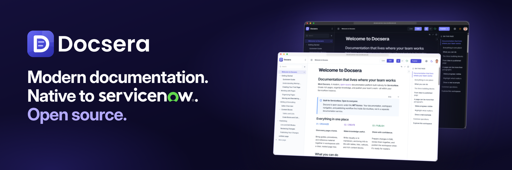

# Docsera

Docsera is an open-source documentation platform built natively for ServiceNow. Create and organize pages in workspaces, edit content visually or with Markdown, and publish changes through a workspace-wide review workflow—all within your ServiceNow instance.

**[Read the Docsera documentation](https://docsera.mintlify.site/)** for end-user guidance and product documentation.

## ✨ Features

- ServiceNow-native workspaces and hierarchical page trees.
- Visual editing and Markdown Source for page content.
- Rich content blocks, including text, lists, links, code, tables, media, and layout-oriented blocks.
- Workspace-level Live and Edit views, with publishing, discard, and change-management workflows.
- ServiceNow-native authorization and workspace membership controls.

## 🧱 Built With

**Development tooling**

## 📚 Documentation

The [Docsera documentation](https://docsera.mintlify.site/) is the primary destination for using Docsera. Repository documentation supplies technical references, installation-package details, and contributor workflows in the [documentation index](docs/README.md).

## 📦 Install Docsera

<table>
<tr><td>

**📦 Install with update sets**

For a consumer installation, use the versioned scoped application and Global companion update-set pair. Install in the required order: **scoped-first, Global-second**.

Check [GitHub Releases](https://github.com/jacobharvell/Docsera/releases) for package availability, then follow the [installation guide](docs/guides/update-set-installation.md). The [0.1.0 package README](releases/0.1.0/README.md) and [consumer release index](releases/README.md) cover package details, prerequisites, and optional integrity checks.

The release package is intended for a new installation; it does not establish an upgrade path.

</td></tr>
</table>

<table>
<tr><td>

**🛠️ Build from SDK source**

For contributors building and deploying to a ServiceNow development instance they control. This route uses Node.js, npm, and the ServiceNow SDK to set up and install the scoped application and its Global companion.

Follow the [source development setup](docs/guides/development-setup.md) for prerequisites, contributor-owned application identity setup, and build and installation steps.

</td></tr>
</table>

## 🛠️ Development and contributing

Docsera has a scoped application source package at [app/docsera-ui/](app/docsera-ui/) and a narrowly scoped Global companion at [app/docsera-global-bridge/](app/docsera-global-bridge/). Start with the [development setup](docs/guides/development-setup.md), [architecture overview](docs/architecture/overview.md), and [contribution guide](CONTRIBUTING.md).

## 🛡️ Support and security

For installation help, defects, and feature requests, see [SUPPORT.md](SUPPORT.md). For private vulnerability-reporting boundaries, see [SECURITY.md](SECURITY.md); do not disclose vulnerabilities in public issues or pull requests.

## 📄 License

Docsera is available under the [MIT License](LICENSE).
